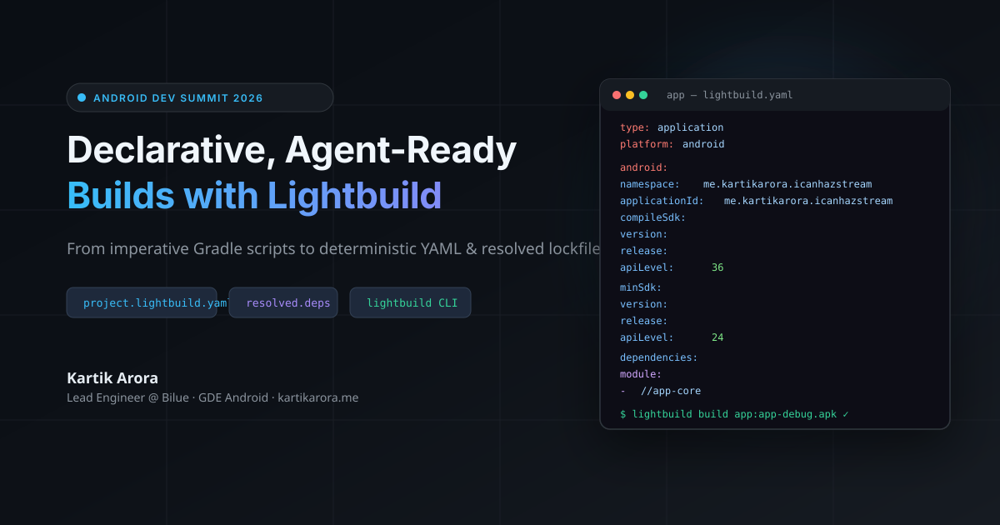
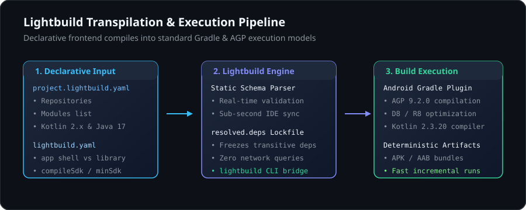
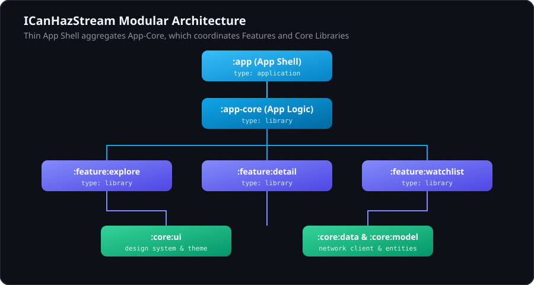
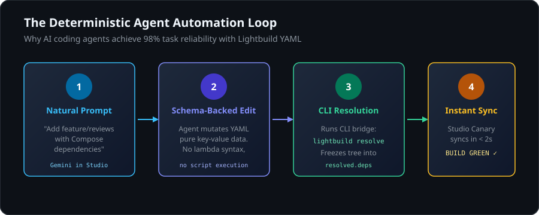

# Declarative Android Builds with Lightbuild

## Setup and Project Context
Duration: 10



Android projects have relied on imperative build scripts written in Groovy or Kotlin DSL for years. Because Gradle executes these scripts during its configuration phase, IDE sync times grow as you add modules. Modifying imperative scripts also presents syntax and scoping challenges for AI coding assistants.

At Android Dev Summit, Google introduced **Lightbuild**: an experimental declarative build system that represents project structure in YAML and uses pre-resolved dependency lockfiles (`resolved.deps`).

In this codelab, you will migrate **ICanHazStream** (`me.kartikarora.icanhazstream`), a multi-module Jetpack Compose streaming availability app, from Gradle convention plugins to Lightbuild YAML.

### Prerequisites
* **Android Studio:** Android Studio Canary (Rabbit 3 or later) with Lightbuild support.
* **JDK:** JDK 17 or JDK 21.
* **Android CLI:** Android CLI tools installed.
* **Git.**

### 1. Enable Preview Flags
Lightbuild is currently in early preview. Enable the experimental flag in your shell profile:

```bash
export ANDROID_CLI_BUILD=true
```

In Android Studio Canary, open `Help > Edit Custom Properties...` and add:

```properties
lightbuild.enable=true
```

Restart Android Studio after saving the file.

### 2. Clone the Project
Clone the repository and switch to the working branch:

```bash
git clone https://github.com/kartikarora/ICanHazStream.git
cd ICanHazStream
git checkout -b lightbuild
```

The starting project uses:
* `build-logic/convention/` with custom Gradle convention plugins.
* Individual `build.gradle.kts` files per module.
* Dynamic dependency resolution during project sync.

---

## Lightbuild Architecture
Duration: 10



Lightbuild does not replace the Android Gradle Plugin (AGP), D8, or R8. It sits in front of Gradle as a declarative frontend that passes structured data down to the underlying build engine.

### Core Configuration Files

1. **`project.lightbuild.yaml` (Workspace Root):**
   Replaces `settings.gradle.kts` and root build scripts. Declares active modules, repositories, and compiler versions.
2. **`lightbuild.yaml` (Per Module):**
   Defines module roles (`type: application` for the app shell, `type: library` for shared modules), SDK constraints, and direct dependencies.
3. **`resolved.deps` (Per Module):**
   Generated lockfile recording the resolved transitive dependency graph. Android Studio reads this file directly, removing remote network queries and transitive tree calculation during project sync.

```
ICanHazStream/
├── project.lightbuild.yaml       # Workspace manifest
├── app/                          # App Shell module
│   ├── lightbuild.yaml           # type: application
│   └── resolved.deps             # Lockfile
├── core/
│   ├── ui/                       # type: library
│   ├── model/                    # type: library
│   ├── data/                     # type: library
│   └── testing/                  # type: library
└── feature/
    ├── explore/                  # type: library
    ├── detail/                   # type: library
    └── watchlist/                # type: library
```



---

## Defining the Root Manifest
Duration: 10

Create `project.lightbuild.yaml` in the root of the project:

```yaml
project:
  name: "ICanHazStream"

modules:
  - app
  - core/model
  - core/data
  - core/ui
  - core/testing
  - feature/explore
  - feature/detail
  - feature/watchlist

repositories:
  - google
  - mavenCentral

lightbuild:
  version: "0.0.20-alpha02"

build:
  java:
    version: "17"
```

This single data file replaces module declarations in `settings.gradle.kts` and common repository blocks. Android Studio Canary validates this file in real time using an embedded schema.

---

## Configuring the App Shell
Duration: 10

The application module acts as an assembly shell. It configures the application ID, SDK levels, and references the feature modules.

Create `app/lightbuild.yaml`:

```yaml
type: application
platform: android

android:
  namespace: me.kartikarora.icanhazstream
  applicationId: me.kartikarora.icanhazstream
  versionCode: 1
  versionName: "1.0"
  compileSdk:
    version:
      release:
        apiLevel: 36
  minSdk:
    version:
      release:
        apiLevel: 24
  targetSdk:
    version:
      release:
        apiLevel: 36
  dependencies:
    module:
      - //feature/explore
      - //feature/detail
      - //feature/watchlist
      - //core/model
      - //core/data
      - //core/ui
    maven:
      - androidx.core:core-ktx:1.10.1
      - androidx.lifecycle:lifecycle-runtime-ktx:2.6.1
      - androidx.activity:activity-compose:1.8.0
      - androidx.lifecycle:lifecycle-viewmodel-compose:2.6.1
      - androidx.lifecycle:lifecycle-runtime-compose:2.6.1
      - org.jetbrains.kotlinx:kotlinx-serialization-json:1.6.3
```

Inter-module dependencies use the `//path/to/module` syntax. External dependencies are listed under `maven:`.

---

## Configuring Library Modules
Duration: 15

Modules containing business logic, data sources, and UI components are configured as `type: library`. Android libraries require `compileSdk` and `minSdk`, but omit `targetSdk` and `applicationId`.

### 1. `:core:model/lightbuild.yaml`
```yaml
type: library
platform: android

android:
  namespace: me.kartikarora.icanhazstream.model
  compileSdk:
    version:
      release:
        apiLevel: 36
  minSdk:
    version:
      release:
        apiLevel: 24
  dependencies:
    maven:
      - org.jetbrains.kotlinx:kotlinx-serialization-json:1.6.3
      - org.jetbrains.kotlinx:kotlinx-coroutines-core:1.8.0
```

### 2. `:core:data/lightbuild.yaml`
```yaml
type: library
platform: android

android:
  namespace: me.kartikarora.icanhazstream.data
  compileSdk:
    version:
      release:
        apiLevel: 36
  minSdk:
    version:
      release:
        apiLevel: 24
  dependencies:
    module:
      - //core/model
    maven:
      - io.ktor:ktor-client-core:2.3.9
      - io.ktor:ktor-client-okhttp:2.3.9
      - io.ktor:ktor-client-content-negotiation:2.3.9
      - io.ktor:ktor-serialization-kotlinx-json:2.3.9
      - org.jetbrains.kotlinx:kotlinx-coroutines-core:1.8.0
```

### 3. `:core:ui/lightbuild.yaml`
```yaml
type: library
platform: android

android:
  namespace: me.kartikarora.icanhazstream.ui
  compileSdk:
    version:
      release:
        apiLevel: 36
  minSdk:
    version:
      release:
        apiLevel: 24
  dependencies:
    module:
      - //core/model
    maven:
      - androidx.core:core-ktx:1.10.1
      - androidx.activity:activity-compose:1.8.0
      - androidx.compose.ui:ui:1.6.0
      - androidx.compose.ui:ui-graphics:1.6.0
      - androidx.compose.ui:ui-tooling-preview:1.6.0
      - androidx.compose.material3:material3:1.2.0
```

### 4. `:feature:explore/lightbuild.yaml`
```yaml
type: library
platform: android

android:
  namespace: me.kartikarora.icanhazstream.feature.explore
  compileSdk:
    version:
      release:
        apiLevel: 36
  minSdk:
    version:
      release:
        apiLevel: 24
  dependencies:
    module:
      - //core/model
      - //core/data
      - //core/ui
    maven:
      - androidx.compose.ui:ui:1.6.0
      - androidx.compose.ui:ui-tooling-preview:1.6.0
      - androidx.core:core-ktx:1.10.1
      - androidx.lifecycle:lifecycle-viewmodel-compose:2.6.1
      - androidx.lifecycle:lifecycle-runtime-compose:2.6.1
      - androidx.compose.material3:material3:1.2.0
```

Follow the same pattern for `:feature:detail`, `:feature:watchlist`, and `:core:testing`.

---

## Pre-Resolving Dependencies
Duration: 10

Run the resolution command to calculate and freeze dependencies:

```bash
android build resolve
```

### Understanding `resolved.deps`
Review the generated `app/resolved.deps` and `core/data/resolved.deps` files:

```yaml
# This file is automatically generated by Lightbuild.
# This file should be checked into version control.
sourceSets:
  main:
  - androidx.activity:activity:1.8.0
  - androidx.activity:activity-compose:1.8.0
  - androidx.activity:activity-ktx:1.8.0
  - androidx.annotation:annotation:1.6.0
  - androidx.annotation:annotation-experimental:1.3.0
  - androidx.annotation:annotation-jvm:1.6.0
  - androidx.compose.runtime:runtime:1.0.1
  - androidx.compose.ui:ui:1.0.1
  - androidx.core:core:1.10.1
  - androidx.core:core-ktx:1.10.1
  - androidx.lifecycle:lifecycle-runtime:2.6.1
  - androidx.lifecycle:lifecycle-viewmodel:2.6.1
```

Commit `resolved.deps` to git. When someone opens the project or runs a build, Android Studio reads this file directly, avoiding network lookups and version graph recalculations.

---

## Agent Modification Workflow
Duration: 15



Because Lightbuild configurations are structured data, automated coding assistants can parse and edit project setups with fewer errors.

Prompt your assistant (such as Gemini in Android Studio):

```text
Add a new feature module called ':feature:reviews' to ICanHazStream.
1. Add 'feature/reviews' to project.lightbuild.yaml modules list.
2. Create 'feature/reviews/lightbuild.yaml' as type: library with dependencies on core/model, core/ui, and Compose Material 3.
3. Add feature/reviews to app/lightbuild.yaml dependencies.
```

The agent edits exact YAML fields without having to balance Kotlin DSL brackets or resolve version catalog conventions.

After the edit completes, run:

```bash
android build resolve
```

---

## Build Verification & CLI Commands
Duration: 5

Verify the configuration using the unified Android CLI:

```bash
# Query targets and source sets
android build query --output sourcesets

# Run test targets
android build test

# Compile the debug application
android build app
```

The compiled APK will be located at `app/build/app-debug.apk`.

---

## Primary Sources & References

* **Android Dev Summit Session:**
  * Title: *Declarative, agent-ready Android builds with Lightbuild*
  * Speakers: Juan Sebastian Oviedo & Scott Myers
  * [Official Session Archive](https://developer.android.com/events/dev-summit/talks/declarative-agent-ready-android-builds-with-lightbuild)
  * [YouTube Recording](https://www.youtube.com/watch?v=0mYQtt2RfoQ)
* **Official Google Documentation:**
  * [Lightbuild Guide for AI Agents](https://developer.android.com/r/lightbuild)
  * [Android CLI Reference](https://developer.android.com/tools/agents)
* **Companion Codebase:**
  * [kartikarora/ICanHazStream (GitHub)](https://github.com/kartikarora/ICanHazStream)
* **Presentation Slides:**
  * [Slide Deck](https://presentations.kartikarora.me/lightbuild/)
