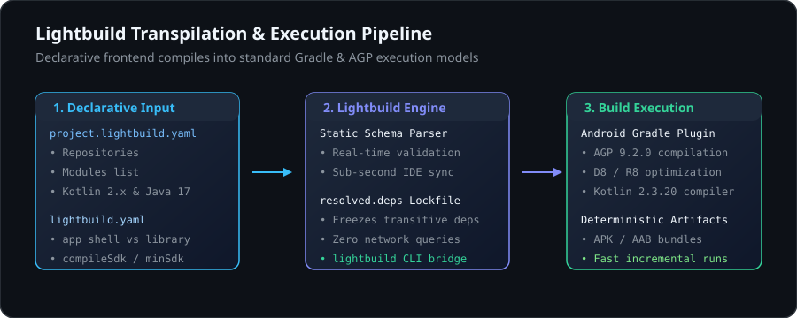
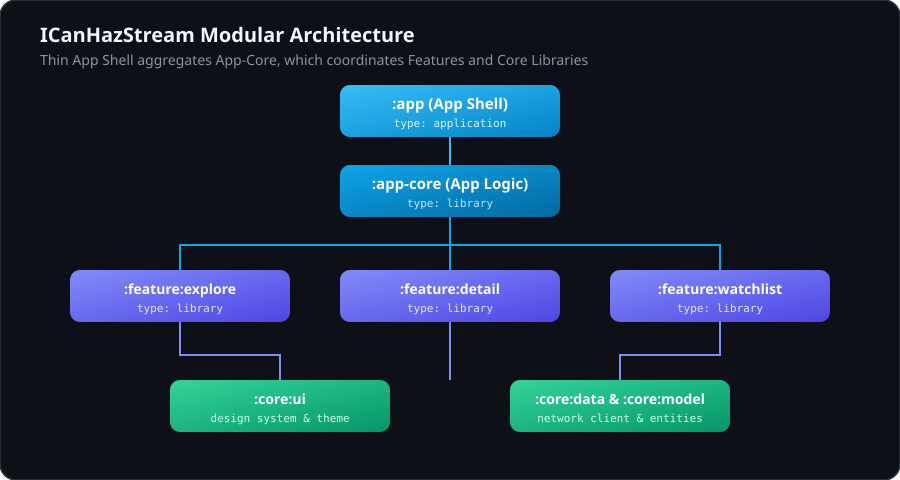
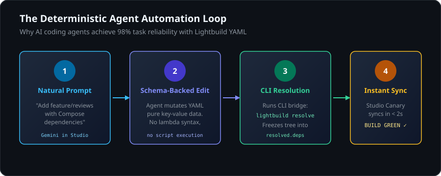

# Declarative Android Builds with Lightbuild

## Setup and Project Context
Duration: 10


Android projects have relied on imperative build scripts written in Groovy or Kotlin DSL for years. Because Gradle executes these scripts during its configuration phase, IDE sync times grow as you add modules. Modifying imperative scripts also presents syntax and scoping challenges for AI coding assistants.

At Android Dev Summit, Google introduced **Lightbuild**: an experimental declarative build system that represents project structure in YAML and uses pre-resolved dependency lockfiles (`resolved.deps`).

In this codelab, you will migrate **ICanHazStream** (`me.kartikarora.icanhazstream`), a multi-module Jetpack Compose streaming availability app, from Gradle convention plugins to Lightbuild YAML.

### Prerequisites
* **Android Studio:** Android Studio Canary (Rabbit 3 or later) with Lightbuild support.
* **JDK:** JDK 21.
* **Android CLI:** Android CLI tools installed.
* **Git.**

### 1. Clone the Project
Clone the repository and check out the starter branch:

```bash
git clone https://github.com/kartikarora/ICanHazStream.git
cd ICanHazStream

# Check out the starter branch
git checkout lightbuild-start

# Create your personal migration branch to work in
git checkout -b my-lightbuild
```

> **Note:** If you ever get stuck or want to inspect the completed solution, the full Lightbuild migration is available on the `lightbuild` branch (`git checkout lightbuild`).

The starting code on `lightbuild-start` is a complete, working multi-module Jetpack Compose app that uses:
* `build-logic/convention/` with custom Gradle convention plugins.
* Individual `build.gradle.kts` files per module.
* Dynamic dependency resolution during project sync.

### 2. Install Lightbuild
Lightbuild is supported out of the box in the latest versions of Android Studio Canary and through the standalone `lightbuild` CLI.

To install the `lightbuild` CLI using the Android CLI:

```bash
# Install the Lightbuild SDK package
android sdk install build/lightbuild/0.0.30

# Run the bundled CLI installer script
bash "$(android info sdk)/build/lightbuild/0.0.30/cli/install.sh"
```

Verify your installation:

```bash
lightbuild --version
```

For full environment prerequisites, see the [Lightbuild Setup Documentation](https://developer.android.com/tools/agents/lightbuild/setup).

---

## Lightbuild Architecture
Duration: 10



Lightbuild is not a complete replacement for Gradle, the Android Gradle Plugin (AGP), or D8/R8, but it takes over several responsibilities from them. Android Studio Canary syncs Lightbuild projects directly from the YAML files and `resolved.deps` without Gradle or AGP, and Lightbuild resolves dependencies itself. At build time, Lightbuild hands compilation and packaging off to Gradle/AGP under the hood as an implementation detail—avoid making workflows depend on the `.lightbuild/gradle` directory.

### Core Configuration Files

1. **`project.lightbuild.yaml` (Workspace Root):**
   Replaces `settings.gradle.kts` and root build scripts. Declares active modules, repositories, and compiler versions.
2. **`lightbuild.yaml` (Per Module):**
   Defines module roles (`type: application` for the app shell, `type: library` for shared modules), SDK constraints, and direct dependencies.
3. **`resolved.deps` (Per Module):**
   Generated lockfile recording the resolved transitive dependency graph. Android Studio reads this file directly, removing remote network queries and transitive tree calculation during project sync.

```
ICanHazStream/
├── project.lightbuild.yaml       # Workspace manifest
├── app/                          # App Shell module (assembly only)
│   ├── lightbuild.yaml           # type: application
│   └── resolved.deps             # Lockfile
├── app-core/                     # Core App Library module
│   ├── lightbuild.yaml           # type: library
│   ├── resolved.deps
│   └── src/                      # App source code (MainActivity, StreamNavGraph)
├── core/
│   ├── ui/                       # type: library
│   ├── model/                    # type: library
│   ├── data/                     # type: library
│   └── testing/                  # type: library
└── feature/
    ├── explore/                  # type: library
    ├── detail/                   # type: library
    └── watchlist/                # type: library
```



---

## Defining the Root Manifest
Duration: 10

Create `project.lightbuild.yaml` in the root of the project:

```yaml
project:
  name: "ICanHazStream"

modules:
  - app
  - app-core
  - core/model
  - core/data
  - core/ui
  - core/testing
  - feature/explore
  - feature/detail
  - feature/watchlist

repositories:
  - google
  - mavenCentral

lightbuild:
  version: "0.0.30"

build:
  java:
    version: "17"
```

This single data file replaces module declarations in `settings.gradle.kts` and common repository blocks. Android Studio Canary validates this file in real time using an embedded schema.

---

## Configuring the App Shell & Core Library
Duration: 10

In Lightbuild projects, application modules are strictly **empty assembly shells**. They configure the application ID, version codes, and SDK constraints, but do **not** host application source code directly. All application logic, entry points (`MainActivity`), and navigation graphs reside in a separate library module (`app-core`).

> In Lightbuild architecture, application modules lack visibility into Kotlin/Java code stored directly inside `app/src/`. Attempting to place application code inside `app` causes runtime class-not-found errors on app launch. The application module must remain a thin assembly shell, with the application logic supplied as an `app-core` library. See [Lightbuild Project Structure](https://developer.android.com/tools/agents/lightbuild/structure#application-module). {.special}

### 1. App Shell: `app/lightbuild.yaml`

Create `app/lightbuild.yaml` configuring the thin assembly shell that depends on `//app-core`:

```yaml
type: application
platform: android

android:
  namespace: me.kartikarora.icanhazstream
  applicationId: me.kartikarora.icanhazstream
  versionCode: 1
  versionName: "1.0"
  compileSdk:
    version:
      release:
        apiLevel: 37
  minSdk:
    version:
      release:
        apiLevel: 24
  targetSdk:
    version:
      release:
        apiLevel: 37
  dependencies:
    module:
      - //app-core
```

### 2. App Core Library: `app-core/lightbuild.yaml`

Move the Kotlin source code (`MainActivity.kt` and `StreamNavGraph.kt`) into `app-core/src/main/kotlin/` and create `app-core/lightbuild.yaml`:

```yaml
type: library
platform: android

android:
  namespace: me.kartikarora.icanhazstream.core
  compileSdk:
    version:
      release:
        apiLevel: 37
  minSdk:
    version:
      release:
        apiLevel: 24
  dependencies:
    module:
      - //feature/explore
      - //feature/detail
      - //feature/watchlist
      - //core/model
      - //core/data
      - //core/ui
    maven:
      - androidx.compose.ui:ui:1.6.0
      - androidx.compose.ui:ui-tooling-preview:1.6.0
      - androidx.compose.material3:material3:1.2.0
      - androidx.compose.material:material-icons-extended:1.6.0
      - androidx.core:core-ktx:1.10.1
      - androidx.lifecycle:lifecycle-runtime-ktx:2.6.1
      - androidx.activity:activity-compose:1.8.0
      - androidx.lifecycle:lifecycle-viewmodel-compose:2.6.1
      - androidx.lifecycle:lifecycle-runtime-compose:2.6.1
      - org.jetbrains.kotlinx:kotlinx-serialization-json:1.6.3
```

Inter-module dependencies use the `//path/to/module` syntax. External dependencies are listed under `maven:`.

---

## Configuring Library Modules
Duration: 15

Modules containing business logic, data sources, and UI components are configured as `type: library`. Android libraries require `compileSdk` and `minSdk`, but omit `targetSdk` and `applicationId`.

### 1. `:core:model/lightbuild.yaml`
```yaml
type: library
platform: android

android:
  namespace: me.kartikarora.icanhazstream.model
  compileSdk:
    version:
      release:
        apiLevel: 37
  minSdk:
    version:
      release:
        apiLevel: 24
  dependencies:
    maven:
      - org.jetbrains.kotlinx:kotlinx-serialization-json:1.6.3
      - org.jetbrains.kotlinx:kotlinx-coroutines-core:1.8.0
```

### 2. `:core:data/lightbuild.yaml`
```yaml
type: library
platform: android

android:
  namespace: me.kartikarora.icanhazstream.data
  compileSdk:
    version:
      release:
        apiLevel: 37
  minSdk:
    version:
      release:
        apiLevel: 24
  dependencies:
    module:
      - //core/model
    maven:
      - io.ktor:ktor-client-core:2.3.9
      - io.ktor:ktor-client-okhttp:2.3.9
      - io.ktor:ktor-client-content-negotiation:2.3.9
      - io.ktor:ktor-serialization-kotlinx-json:2.3.9
      - org.jetbrains.kotlinx:kotlinx-coroutines-core:1.8.0
```

### 3. `:core:ui/lightbuild.yaml`
```yaml
type: library
platform: android

android:
  namespace: me.kartikarora.icanhazstream.ui
  compileSdk:
    version:
      release:
        apiLevel: 37
  minSdk:
    version:
      release:
        apiLevel: 24
  dependencies:
    module:
      - //core/model
    maven:
      - androidx.core:core-ktx:1.10.1
      - androidx.activity:activity-compose:1.8.0
      - androidx.compose.ui:ui:1.6.0
      - androidx.compose.ui:ui-graphics:1.6.0
      - androidx.compose.ui:ui-tooling-preview:1.6.0
      - androidx.compose.material3:material3:1.2.0
```

### 4. `:feature:explore/lightbuild.yaml`
```yaml
type: library
platform: android

android:
  namespace: me.kartikarora.icanhazstream.feature.explore
  compileSdk:
    version:
      release:
        apiLevel: 37
  minSdk:
    version:
      release:
        apiLevel: 24
  dependencies:
    module:
      - //core/model
      - //core/data
      - //core/ui
    maven:
      - androidx.compose.ui:ui:1.6.0
      - androidx.compose.ui:ui-tooling-preview:1.6.0
      - androidx.core:core-ktx:1.10.1
      - androidx.lifecycle:lifecycle-viewmodel-compose:2.6.1
      - androidx.lifecycle:lifecycle-runtime-compose:2.6.1
      - androidx.compose.material3:material3:1.2.0
  tests:
    test:
      dependencies:
        module:
          - //core/testing
        maven:
          - junit:junit:4.13.2
          - app.cash.turbine:turbine:1.2.1
          - org.jetbrains.kotlinx:kotlinx-coroutines-test:1.8.0
```

Follow the same pattern for `:feature:detail` and `:feature:watchlist` (including the same `tests:` block in `feature/watchlist/lightbuild.yaml`).

### 5. Migrating Host Unit Tests to JUnit 4 (`:core:testing` & Feature Tests)

> On the Gradle starter branch (`lightbuild-start`), `AndroidFeatureConventionPlugin.kt` enables `useJUnitPlatform()` so Gradle runs JUnit 5 tests natively. Because Lightbuild `0.0.30` executes Android host unit tests on **JUnit 4** (`junit:junit:4.13.2`), update `:core:testing` and the feature unit tests to JUnit 4 and remove unused `src/androidTest` files unless you configure an `androidTest` block.

Create `core/testing/lightbuild.yaml` using `junit:junit:4.13.2`:

```yaml
type: library
platform: android

android:
  namespace: me.kartikarora.icanhazstream.testing
  compileSdk:
    version:
      release:
        apiLevel: 37
  minSdk:
    version:
      release:
        apiLevel: 24
  dependencies:
    module:
      - //core/model
      - //core/data
    maven:
      - junit:junit:4.13.2
      - androidx.arch.core:core-testing:2.2.0
      - org.jetbrains.kotlinx:kotlinx-coroutines-core:1.8.0
      - org.jetbrains.kotlinx:kotlinx-coroutines-test:1.8.0
      - app.cash.turbine:turbine:1.2.1
```

Remove the JUnit 5 `MainDispatcherExtension.kt` and the unconfigured `src/androidTest` directories:

```bash
rm -rf core/testing/src/main/kotlin/me/kartikarora/icanhazstream/testing/MainDispatcherExtension.kt
rm -rf feature/explore/src/androidTest feature/watchlist/src/androidTest
```

Create `core/testing/src/main/kotlin/me/kartikarora/icanhazstream/testing/MainDispatcherRule.kt` using JUnit 4's `TestWatcher`:

```kotlin
package me.kartikarora.icanhazstream.testing

import androidx.arch.core.executor.ArchTaskExecutor
import androidx.arch.core.executor.TaskExecutor
import kotlinx.coroutines.Dispatchers
import kotlinx.coroutines.ExperimentalCoroutinesApi
import kotlinx.coroutines.test.TestDispatcher
import kotlinx.coroutines.test.UnconfinedTestDispatcher
import kotlinx.coroutines.test.resetMain
import kotlinx.coroutines.test.setMain
import org.junit.rules.TestWatcher
import org.junit.runner.Description

/**
 * JUnit 4 rule that swaps [Dispatchers.Main] and [ArchTaskExecutor] for deterministic coroutine tests.
 */
@OptIn(ExperimentalCoroutinesApi::class)
class MainDispatcherRule(
    val testDispatcher: TestDispatcher = UnconfinedTestDispatcher(),
) : TestWatcher() {

    override fun starting(description: Description) {
        Dispatchers.setMain(testDispatcher)
        ArchTaskExecutor.getInstance().setDelegate(object : TaskExecutor() {
            override fun executeOnDiskIO(runnable: Runnable) {
                runnable.run()
            }

            override fun postToMainThread(runnable: Runnable) {
                runnable.run()
            }

            override fun isMainThread(): Boolean = true
        })
    }

    override fun finished(description: Description) {
        Dispatchers.resetMain()
        ArchTaskExecutor.getInstance().setDelegate(null)
    }
}
```

Update `feature/explore/src/test/kotlin/me/kartikarora/icanhazstream/explore/TrendingMoviesViewModelTest.kt`:

```kotlin
package me.kartikarora.icanhazstream.explore

import me.kartikarora.icanhazstream.testing.FakeMovieRepository
import me.kartikarora.icanhazstream.testing.MainDispatcherRule
import org.junit.Assert.assertTrue
import org.junit.Before
import org.junit.Rule
import org.junit.Test

/**
 * Unit tests for [TrendingMoviesViewModel] using [FakeMovieRepository].
 */
class TrendingMoviesViewModelTest {

    @get:Rule
    val mainDispatcherRule = MainDispatcherRule()

    private lateinit var repository: FakeMovieRepository
    private lateinit var viewModel: TrendingMoviesViewModel

    @Before
    fun setup() {
        repository = FakeMovieRepository()
        viewModel = TrendingMoviesViewModel(repository)
    }

    @Test
    fun initialStateHasEmptyMoviesList() {
        assertTrue(viewModel.trendingMovies.value.isEmpty())
    }
}
```

Update `feature/watchlist/src/test/kotlin/me/kartikarora/icanhazstream/watchlist/WatchlistViewModelTest.kt`:

```kotlin
package me.kartikarora.icanhazstream.watchlist

import app.cash.turbine.test
import kotlinx.coroutines.test.runTest
import me.kartikarora.icanhazstream.model.Movie
import me.kartikarora.icanhazstream.testing.MainDispatcherRule
import org.junit.Assert.assertTrue
import org.junit.Before
import org.junit.Rule
import org.junit.Test

/**
 * Unit tests for [WatchlistViewModel] using Turbine.
 */
class WatchlistViewModelTest {

    @get:Rule
    val mainDispatcherRule = MainDispatcherRule()

    private lateinit var repository: DefaultWatchlistRepository
    private lateinit var viewModel: WatchlistViewModel

    @Before
    fun setup() {
        repository = DefaultWatchlistRepository()
        viewModel = WatchlistViewModel(repository)
    }

    @Test
    fun initialWatchlistStateLoadsPrePopulatedMovies() = runTest {
        viewModel.watchlist.test {
            val initial = awaitItem()
            assertTrue(initial.isNotEmpty())
        }
    }

    @Test
    fun addingMovieToWatchlistUpdatesFlow() = runTest {
        val newMovie = Movie(id = "test_movie", title = "Test Movie", overview = "Overview")

        viewModel.watchlist.test {
            awaitItem() // initial state

            viewModel.toggleWatchlist(newMovie)

            val updated = awaitItem()
            assertTrue(updated.any { it.id == "test_movie" })
        }
    }

    @Test
    fun removingMovieFromWatchlistUpdatesFlow() = runTest {
        val movieToRemove = viewModel.watchlist.value.first()

        viewModel.watchlist.test {
            awaitItem() // initial state

            viewModel.removeFromWatchlist(movieToRemove.id)

            val updated = awaitItem()
            assertTrue(updated.none { it.id == movieToRemove.id })
        }
    }
}
```

---

## Dependency Resolution & Lockfiles
Duration: 10

In Lightbuild, `lightbuild build`, `lightbuild test`, and Android Studio Canary run tasks will **all automatically resolve dependencies** and generate/update `resolved.deps` whenever `lightbuild.yaml` changes.

Calling `lightbuild resolve` directly is not mandatory before building, but it is useful when you want to:
1. **Pre-warm the cache / lock dependencies** before writing code that imports them.
2. **Verify dependency health in CI** using `lightbuild resolve --locked-dependencies`, ensuring lockfiles are strictly up to date.

To manually pre-resolve dependencies:

```bash
lightbuild resolve
```

### Understanding `resolved.deps`
Review the generated `app/resolved.deps` and `core/data/resolved.deps` files:

```yaml
# This file is automatically generated by Lightbuild.
# This file should be checked into version control.
sourceSets:
  main:
  - androidx.activity:activity:1.8.0
  - androidx.activity:activity-compose:1.8.0
  - androidx.activity:activity-ktx:1.8.0
  - androidx.annotation:annotation:1.6.0
  - androidx.annotation:annotation-experimental:1.3.0
  - androidx.annotation:annotation-jvm:1.6.0
  - androidx.compose.runtime:runtime:1.0.1
  - androidx.compose.ui:ui:1.0.1
  - androidx.core:core:1.10.1
  - androidx.core:core-ktx:1.10.1
  - androidx.lifecycle:lifecycle-runtime:2.6.1
  - androidx.lifecycle:lifecycle-viewmodel:2.6.1
```

Commit `resolved.deps` to git. When someone opens the project or runs a build, Android Studio reads this file directly, avoiding network lookups and version graph recalculations.

---

## Agent Modification Workflow
Duration: 15



Because Lightbuild configurations are structured data, automated coding assistants can parse and edit project setups with fewer errors.

Prompt your assistant (such as Gemini in Android Studio):

```text
Add a new feature module called ':feature:reviews' to ICanHazStream.
1. Add 'feature/reviews' to project.lightbuild.yaml modules list.
2. Create 'feature/reviews/lightbuild.yaml' as type: library with dependencies on core/model, core/ui, and Compose Material 3.
3. Add feature/reviews to app-core/lightbuild.yaml dependencies (so the navigation graph in app-core can access it).
```

The agent edits exact YAML fields without having to balance Kotlin DSL brackets or resolve version catalog conventions.

Because build tasks auto-resolve dependencies on demand, you can immediately build the target or pre-warm via CLI:

```bash
lightbuild resolve
```

---

## Build Verification & CLI Commands
Duration: 5

Verify the configuration using the standalone `lightbuild` CLI:

```bash
# Query targets and source sets
lightbuild query ... --output sourcesets

# Run host unit tests
lightbuild test feature/explore:hostTest
lightbuild test feature/watchlist:hostTest

# Compile the debug application
lightbuild build app:app-debug.apk
```

The compiled APK will be located at `app/build/app-debug.apk`.

---

## Primary Sources & References

* **Android Dev Summit Session:**
  * Title: *Declarative, agent-ready Android builds with Lightbuild*
  * Speakers: Juan Sebastian Oviedo & Scott Myers
  * [Official Session Archive](https://developer.android.com/events/dev-summit/talks/declarative-agent-ready-android-builds-with-lightbuild)
  * [YouTube Recording](https://www.youtube.com/watch?v=0mYQtt2RfoQ)
* **Official Google Documentation:**
  * [Lightbuild Guide for AI Agents](https://developer.android.com/r/lightbuild)
  * [Android CLI Reference](https://developer.android.com/tools/agents)
* **Companion Codebase:**
  * [kartikarora/ICanHazStream (GitHub)](https://github.com/kartikarora/ICanHazStream)
* **Presentation Slides:**
  * [Slide Deck](https://presentations.kartikarora.me/lightbuild/)
